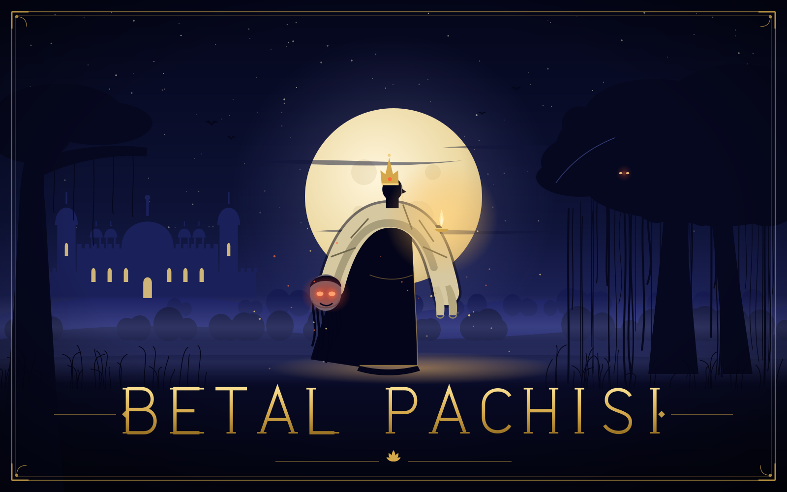
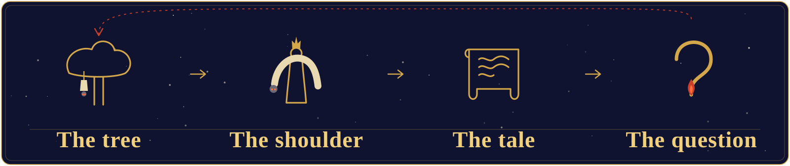
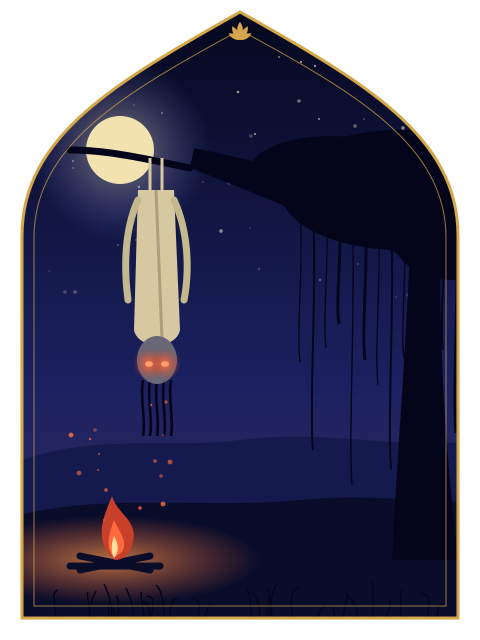
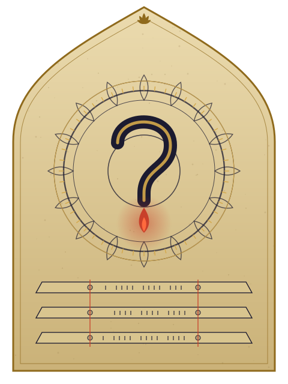
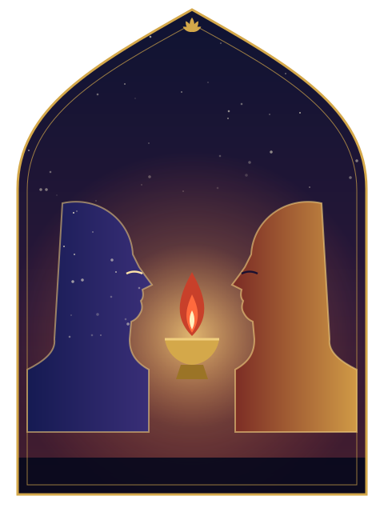
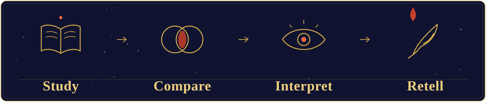
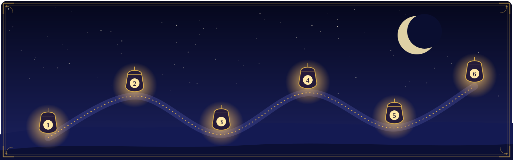
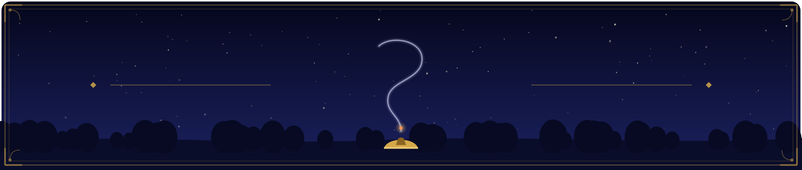

<h1 align="center">
  
</h1>

<h3 align="center"><em>Twenty-five tales. One king. One corpse that will not stop talking.</em></h3>

  Horror is the doorway. The human story is what waits beyond it.

  बेताल पच्चीसी &nbsp;·&nbsp; विक्रम और बेताल की कथाएँ

  

  A long-term creative project to retell the tales of <strong>Betal Pachisi</strong> as an immersive, 
  illustrated, bilingual story experience, and the research archive that stands behind it.

 

## A king. A corpse. A very long night.

> Midnight, in a cremation ground. A king lifts a corpse down from its tree and sets it on his shoulder.
>
> **The corpse speaks.**

It is **Betal**, a *vetala*: a spirit that has made a dead body its home. He will tell the king a story to pass the road. The story ends in a question, and the question cannot be left unanswered. The moment the king speaks, Betal slips free and returns to his tree. The king walks back to fetch him again.

Twenty-five times.

  

<table width="100%">
  <tr>
    <td align="center" width="25%"><b>The tree</b></td>
    <td align="center" width="25%"><b>The shoulder</b></td>
    <td align="center" width="25%"><b>The tale</b></td>
    <td align="center" width="25%"><b>The question</b></td>
  </tr>
</table>

 

## Three doors into one night

<table width="100%">
  <tr>
    <td align="center" width="33%"></td>
    <td align="center" width="33%"></td>
    <td align="center" width="33%"></td>
  </tr>
  <tr>
    <td align="center"><h4>I · The Night</h4></td>
    <td align="center"><h4>II · The Riddle</h4></td>
    <td align="center"><h4>III · The Human</h4></td>
  </tr>
</table>

**The Night.** Ghosts and spirits, cremation grounds, hidden kingdoms, bargains with the dead. This is where the tales catch you, and it is meant to unsettle.

**The Riddle.** Every tale closes on a question that does not give way: love divided between claimants, loyalty set against honour, generosity that may be folly. The king has to choose.

**The Human.** Under every ghost there is someone afraid, someone in love, someone ambitious, deceitful, or willing to give everything away. The supernatural gets you through the door. The people are why you stay.

  

## Philosophy without the lecture

The most interesting thing about these stories is a trick the great storytellers share. The idea is so well hidden inside the plot that it never feels like an idea. Nobody delivers a sermon. A character chooses, something is lost, and the tale moves on.

  <b>No moral stapled to the last page.</b> 
  <b>A choice. A consequence. A question.</b> 
  <b>What you carry out of the story is yours.</b>

The guiding line of the project puts the order of things plainly:

> **Entertainment draws the reader in. Storytelling holds them there. Reflection is what may stay with them.**

A tale has to be worth hearing before it is worth thinking about. Depth is welcome, but it must emerge from character, suspense and consequence, never be attached afterwards.

 

## Many tellings, one honest approach

These tales have travelled through Sanskrit and Hindi tellings, and the tellings disagree. A question changes shape. An answer reverses. An ending exists in one version and vanishes in another. That variation is part of the story's history, so the project treats it as evidence, not noise.

  

<table width="100%">
  <tr>
    <td align="center" width="25%"><b>Study</b></td>
    <td align="center" width="25%"><b>Compare</b></td>
    <td align="center" width="25%"><b>Interpret</b></td>
    <td align="center" width="25%"><b>Retell</b></td>
  </tr>
</table>

- **Not bound to one version.** The aim is the strongest coherent retelling. A tale may take its setting from one tradition and its ending from another, but only when the result is stronger, and only when its logic and central dilemma survive.
- **Honest about what is borrowed and what is invented.** Sources and creative additions are recorded, and an invention is never presented as something a source says.
- **Twenty-five distinct tales.** The collection means the tales Betal himself narrates. The outer story of Vikram and Betal frames them and is not one of the twenty-five. A plot told twice counts once, unless its dilemma is genuinely different.
- **Hindi first.** The stories are written in Hindi, and English is a literary adaptation in its own right, not a word-for-word translation.

  

## What it hopes to become

It should feel like **entering a story**, not visiting a website: narration, illustration, atmosphere and sound working as one act of telling, with the night, the forest and the weight of each riddle felt rather than described. That is the intention. This README describes a creative aim, not a released product, and the way it will be built is still open.

 

## A note from the creator

  

> What pulled me in first was the audacity. A king carries a corpse through the night, and the corpse tells stories. The ghosts, the spirits, the strange worlds and the stakes are so inventive that I was hooked before I had asked a single serious question.
>
> Then I found what lies underneath: love, fear, desire, ambition, loyalty, sacrifice, deceit, courage. People choosing badly, choosing bravely, choosing for reasons that contradict each other. The horror is the way in. The people are the reason to stay.
>
> What I love most is the moment when a philosopher turns out to be a fierce storyteller, and the philosophy stops being a lecture. It becomes plot, character, decision and consequence. You learn something without ever being taught.
>
> I believe we learn, live and evolve through the stories we tell and hear. This project is my attempt to honour that, with care for the people and traditions that carried these tales to us.

  

 

## The archive, by lantern

The README only introduces. The detail lives in the documents, and six lanterns mark the way.

  

<table width="100%">
  <tr>
    <td width="50%" valign="top">
      <b>1 · <a href="docs/PROJECT_VISION.md">Project Vision</a></b> 
      What is being made, for whom, and what it is not.
    </td>
    <td width="50%" valign="top">
      <b>2 · <a href="docs/STORYTELLING_NORTH_STAR.md">Storytelling North Star</a></b> 
      The creative compass: entertainment first, depth that emerges, no forced morals.
    </td>
  </tr>
  <tr>
    <td valign="top">
      <b>3 · <a href="docs/research/CANDIDATE_TALE_CATALOGUE.md">Candidate Tale Catalogue</a></b> 
      The tales found across the traditions, mapped family by family.
    </td>
    <td valign="top">
      <b>4 · <a href="docs/selection/README.md">Selection Dossier</a></b> 
      The dilemmas, overlaps and variety to weigh when choosing the twenty-five.
    </td>
  </tr>
  <tr>
    <td valign="top">
      <b>5 · <a href="docs/research/SOURCE_TRADITIONS_COMPARISON.md">Source Traditions Comparison</a></b> 
      The Sanskrit and Hindi tellings, set side by side.
    </td>
    <td valign="top">
      <b>6 · <a href="docs/DECISIONS.md">Decision Register</a></b> 
      Every agreed principle, and the reasoning behind it.
    </td>
  </tr>
</table>

 

  

<h3 align="center"><em>A tale ends. A question stays.</em></h3>

  एक कथा समाप्त होती है। एक प्रश्न शेष रह जाता है।

 

  The artwork in this README is original to it and sets no direction for the future work; the visual direction of the project is governed by <a href="docs/ART_DIRECTION.md">Art Direction</a>.

